# Fleet Rehearsal GitHub build map

**90 task blocks · 10 phases · 3 agent lanes**

Build a Cisco partner-style tool that plans maintenance waves, checks that critical services retain a healthy uplink in a modeled network, and blocks a previously approved wave when its supporting evidence changes. The hosted release uses two synthetic customer tenants, Catalyst 9300 advisory evidence, and simulated upgrades and rollback.

The work goes from a clean GitHub repository to a verified EKS release. Each task has an owner, model, reasoning level, prerequisites, and a check that closes it. The final three blocks are optional.

**Start with FR-01 and FR-02.** The first handoff is FR-17. Once the contract and the peer-down fixture are pinned, Codex can start FR-18, Claude can start FR-28 and FR-29, and Gemini can start FR-24.

## Flow from setup to release

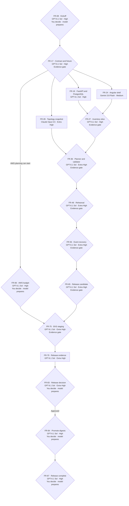

Solid arrows in the phase charts are prerequisites inside that phase. Prior-phase requirements appear inside the affected blocks and in the **Blocked by** column. All listed prerequisites must pass. Diamonds are gates. **Evidence gate** means the assigned model checks tests and artifacts. **You decide** marks a human decision backed by the listed model. If a gate fails, link the failing test or review finding in its issue, fix the responsible block, and rerun the gate against the replacement commit. The weeks below are the original pacing estimate. Dependencies determine when work is ready.

| Week | Focus | Checkpoint |
| --- | --- | --- |
| 1 | Repository, contracts, and inventory slice | All three worktrees use the same contract SHA. Angular reads scoped evidence from FastAPI and PostgreSQL. |
| 2 | Planner and validator | The same input produces the same waves. An independent verifier rejects an unsafe wave. |
| 3 | Approval and rehearsal | The full UI journey proves that an approved wave stops after its alternate path goes down. |
| 4 | Kafka, recovery, security, and monitoring | Duplicate and late events, restarts, revoked access, and stale evidence pass the regression suite. |
| 5 | EKS staging and recovery drill | Deploy pinned images, run the real browser workflow, and demonstrate image rollback and database restore. |
| 6 | Benchmarks, hosted promotion, and handoff | Publish measured results and promote the tested digests after a human go/no-go decision. |

## Phase index

- [0 · Scope, GitHub, and agent setup](#phase-0)
- [1 · Contracts and evidence fixtures](#phase-1)
- [2 · First working inventory slice](#phase-2)
- [3 · Planner and independent validator](#phase-3)
- [4 · Approvals, rehearsal, and audit](#phase-4)
- [5 · Kafka and recovery](#phase-5)
- [6 · Security, observability, and CI](#phase-6)
- [7 · Terraform, EKS, and staging](#phase-7)
- [8 · Benchmark, release, and ownership](#phase-8)
- [9 · Optional work after release](#phase-9)

## Worktree ownership and model setup

| Lane | Write scope | Use higher effort for |
| --- | --- | --- |
| **Codex** | `contracts/`, `fixtures/`, `api/` outside the planner paths, `infra/`, `deploy/`, `ops/`, and `.github/`. Own the API contract and shared fixtures. | Tenant boundaries, approval-to-start transactions, event ordering and recovery, and deployment or rollback reviews. Use Medium for repo administration, High for normal work, and Extra High for these cases. |
| **Claude Code** | `api/fleet/planner/` and `api/tests/planner/`. Review backend changes from a pinned commit and leave findings in the owning issue. | Graph invariants, pathological scheduling inputs, and independent review of concurrency and durability. Use High for bounded implementation and Extra High for design and verification. |
| **Google Antigravity** | `web/`, including browser tests. Codex owns updates to generated contract output. Submit shared fixture and API change requests to Codex. Draft docs and demo material in the assigned issue or PR. | Cross-stack browser failures, auth and accessibility paths, and staging validation. Use Medium for fixture-driven UI work and High for integration and failure journeys. |
| **You** | Repository settings, AWS account decisions, release approval and promotion. The gate block's assigned model prepares the evidence. | Scope changes, cloud budget, launch, and incident decisions. |

Use these profiles from the appropriate worktree. Confirm model access in the signed-in CLI before assigning work. Personal Google AI plans use `agy`. Run `agy models` after signing in to confirm the available slugs. [Codex model selection](https://learn.chatgpt.com/docs/models?surface=cli) · [Claude Code model configuration](https://code.claude.com/docs/en/model-config) · [Google's Antigravity transition](https://developers.googleblog.com/an-important-update-transitioning-gemini-cli-to-antigravity-cli/) · [Antigravity model and effort flags](https://antigravity.google/docs/cli/headless/)

```powershell
codex --model gpt-6.1-sol -c model_reasoning_effort=medium
codex --model gpt-6.1-sol -c model_reasoning_effort=high
codex --model gpt-6.1-sol -c model_reasoning_effort=xhigh

claude --model claude-opus-5-5 --effort high
claude --model claude-opus-5-5 --effort xhigh

agy --model gemini-3.8-flash-medium
agy --model gemini-3.8-flash-high
```

## Run the plan in GitHub

1. **Create a milestone issue per phase.** Use its task list for the phase's FR blocks. Open a standalone issue when a block needs its own PR or can block another lane. Put the FR ID in the title, and link the actual GitHub issue number after creation. Use **Blocked by** relationships between issues. [GitHub issue dependencies](https://docs.github.com/en/issues/tracking-your-work-with-issues/using-issues/creating-issue-dependencies)
2. **Keep one active implementation per worktree.** Branch from the recorded base SHA. Pick the next Ready block in each lane. A read-only review can happen while another lane is implementing. Refresh the worktree from `main` when its declared prerequisites merge.
3. **Keep the contract in one place.** Codex owns `contracts/openapi.yaml`, event schemas, and the shared casebook. If another lane finds a missing field or ambiguous reason, it opens a contract issue with a failing fixture. Land that contract change and regenerate the client before dependent branches continue.
4. **Hand off using a commit and a reproducible check.** Link the issue, PR, exact SHA, and CI run. For a partial handoff, record the blocker and the smallest next action. Ask a different lane to review the parts it will consume.
5. **Merge with evidence.** Check the current PR revision, then rerun required verification on the merged candidate before promotion. Use required checks and environment restrictions where your GitHub plan supports them. Model reviews are evidence for your merge decision. If protected production approvals are unavailable on the plan, use a human-controlled release identity and record the decision in the release issue. [Protected branches](https://docs.github.com/en/repositories/configuring-branches-and-merges-in-your-repository/managing-protected-branches/about-protected-branches) · [GitHub environments and plan limits](https://docs.github.com/en/actions/how-tos/deploy/configure-and-manage-deployments/manage-environments)

**Issue brief for the assigned agent**

```text
FR-__  <block title>
Model and effort
Base SHA and dependency issue links
Allowed write paths
Build and acceptance checks from the matching block
Run the checks. Return commit SHA, CI link, result and next consumer.
If blocked, explain what decision or evidence is missing.
```

**Handoff example**

> FR-30 ready at <SHA>. The validator returns `alternate_path_unavailable` for `peer_down_after_approval` and accepts the healthy control case. Planner test command and results are attached. FR-34 can consume the validator result. FR-39 can reuse the validator when it checks the latest evidence before start.

Worktrees separate checkouts. Keep production secrets and release permissions in an identity agents cannot access. Keep AWS deployment jobs separate from PR checks. Plan load tests and rollback drills in separate staging windows, or use isolated environments. [GitHub Actions OIDC for AWS](https://docs.github.com/en/actions/how-tos/secure-your-work/security-harden-deployments/oidc-in-aws)

## Technical decisions to pin in the first contract

- **Runtime.** Angular calls FastAPI. PostgreSQL stores evidence, grants, plans, approvals, wave state, reservations, audit events, and the outbox. A separate Python worker runs rehearsals and projects Kafka observations. The planner is a pure Python package with no database or network calls.
- **Evidence.** Start with public CVE-2025-20311 source material and a small, hand-checked Catalyst 9300 fixture. Record the source URL, revision, and check date. Affected status depends on applicable release and configuration facts. A missing fact becomes `needs_evidence`. The demo uses a curated, pinned target list. [Cisco advisory](https://www.cisco.com/c/en/us/support/docs/csa/cisco-sa-cat9k-PtmD7bgy.html) · [Cisco Software Checker API documentation](https://developer.cisco.com/docs/psirt/obtain-advisory-by-software/)
- **Safety in the model.** A wave is site-local. The start transaction owns one active wave reservation per site. The validator removes unavailable nodes and links and checks each modeled critical service for an uplink. Store a plan revision, policy version, and evidence versions. Require up-to-date projections and fresh evidence at start. Commit the start or block with its audit record. Treat the modeled topology and simulator as the extent of the claim.
- **Reliability.** Persist the accepted observation and outbox record together, apply Kafka events idempotently, and check accepted versus applied evidence before a wave starts. For each asset and source, revisions advance monotonically. Use one transaction for a simulated step and its durable effects, or an idempotent effect key if a step is delivered again.
- **Cloud.** Develop in Docker Compose. Deploy API and worker workloads and the Angular console on EKS, with PostgreSQL on private RDS and images in ECR. Scope the hosted simulator to one persistent internal Kafka broker and document its recovery limits. Choose a real budget before provisioning staging or hosted production. [EKS pricing](https://aws.amazon.com/eks/pricing/) · [RDS backup and restore](https://docs.aws.amazon.com/AmazonRDS/latest/gettingstartedguide/managing-backup-restore.html)

## Phase 0

### Scope, GitHub, and agent setup

Set the release boundary and give each agent a separate checkout. You approve cloud spend and releases.

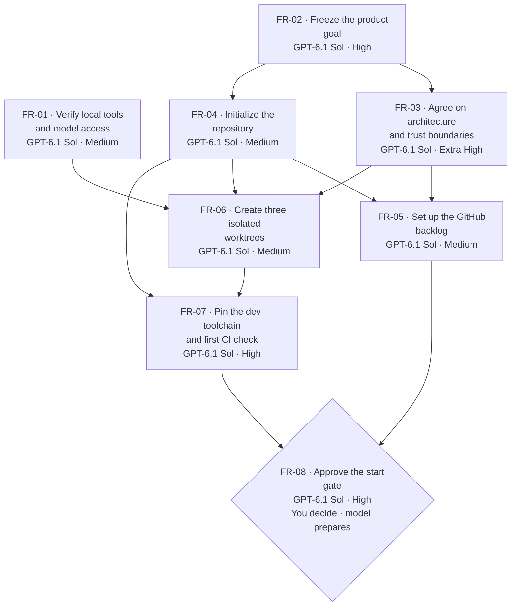

| Block | Owner · model · reasoning | Blocked by | Build | Done when |
| --- | --- | --- | --- | --- |
| **FR-01** Verify local tools and model access | Codex · GPT-6.1 Sol · Medium | — | Record Git, Docker Compose, Python, Node, and CLI versions. Confirm GPT-6.1 Sol, Opus 5.5, and the desired Gemini preset in the signed-in clients. Use agy for personal Google AI subscriptions. | Each agent starts a harmless session with its assigned model in its own terminal. Record the actual model and effort, or flag the unavailable slot. |
| **FR-02** Freeze the product goal | Codex · GPT-6.1 Sol · High | — | Define the operator, two customer tenants, one Catalyst 9300 fleet model, the peer-down-after-approval story, and the hosted synthetic release boundary. List acceptance goals and the first cut. | One short scope decision defines the first usable slice, release gate, and simulated device actions. |
| **FR-03** Agree on architecture and trust boundaries | Codex · GPT-6.1 Sol · Extra High | FR-02 | Record how Angular, FastAPI, PostgreSQL, the Python worker, and Kafka fit together. Identify who can view, propose, approve, and rehearse. Identify failures involving cross-tenant data, stale state, concurrency, and credential access. | The architecture decision record names the source of truth, write owners, trust boundaries, and the four failure cases the design must handle. |
| **FR-04** Initialize the repository | Codex · GPT-6.1 Sol · Medium | FR-02 | Create the initial main commit with a README, ignore rules, directories, and an environment example with dummy values. Decide repository visibility before publishing it. | A clean clone has an initial commit. Local secrets, database dumps, and test outputs are ignored. |
| **FR-05** Set up the GitHub backlog | Codex · GPT-6.1 Sol · Medium | FR-03, FR-04 | Create milestone issues, labels, a shared issue/PR checklist, and a view for Ready, In progress, Review, Blocked, and Done. Keep each FR identifier in the title or checklist, with actual GitHub issue links for dependencies. | A sample FR issue shows its acceptance check and blocking issue. The maintainer can find ready work and link a PR. |
| **FR-06** Create three isolated worktrees | Codex · GPT-6.1 Sol · Medium | FR-01, FR-03, FR-04 | Give Codex the API and deployment directories, Claude the planner package and planner tests, and Gemini the web app and browser tests. Set distinct Compose project names or ports if they run concurrently. | All three checkouts begin from a recorded commit and have non-overlapping write ownership. Shared contracts have one writer. |
| **FR-07** Pin the dev toolchain and first CI check | Codex · GPT-6.1 Sol · High | FR-04, FR-06 | Pin supported Python and Node versions and dependency locking conventions. Add a repeatable bootstrap and verification command. Start the pull-request workflow with the checks the skeleton can actually run. | A clean checkout runs the skeleton check locally and from GitHub Actions on the PR head. |
| **FR-08** Approve the start gate | You decide. Codex prepares · GPT-6.1 Sol · High | FR-05, FR-07 | Prepare the repo links, model/access check, ownership, scope, and initial CI evidence. You confirm the scope and authorize implementation through the planned branch workflow. | The kickoff issue records the base SHA and all three lanes. Any missing tool or access is assigned to an owner. |

## Phase 1

### Contracts and evidence fixtures

Make the boundaries stable enough for three agents to start without changing the same files.

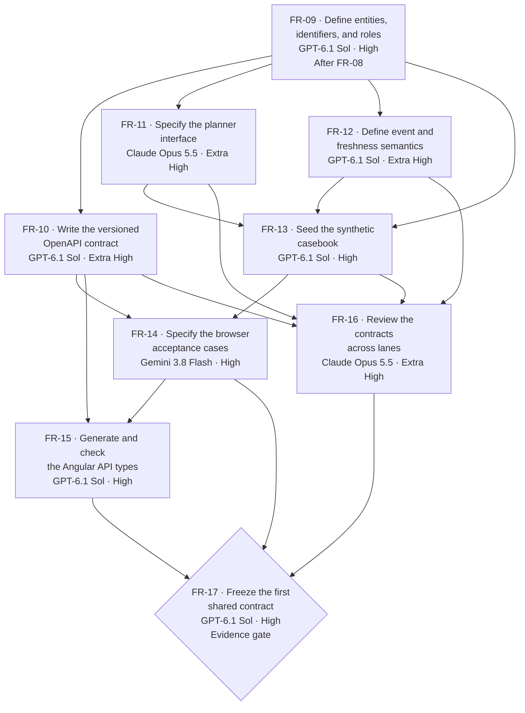

| Block | Owner · model · reasoning | Blocked by | Build | Done when |
| --- | --- | --- | --- | --- |
| **FR-09** Define entities, identifiers, and roles | Codex · GPT-6.1 Sol · High | FR-08 | Specify tenant, site, asset, advisory revision, observation, topology snapshot, plan revision, wave, approval, run, and audit event. Write the permission matrix for viewer, partner proposer, customer approver, and operator. | A fixture or schema sketch shows tenant-qualified relationships and explicit actor permissions. The matrix covers partner scope and approval separation. |
| **FR-10** Write the versioned OpenAPI contract | Codex · GPT-6.1 Sol · Extra High | FR-09 | Specify inventory, evidence, plan preview, approval, rehearsal start and status, and audit reads. Define pagination, machine-readable errors, optimistic preconditions, and idempotency semantics. | contracts/openapi.yaml validates and includes example success, needs-evidence, blocked, stale-revision, and forbidden responses. |
| **FR-11** Specify the planner interface | Claude Code · Claude Opus 5.5 · Extra High | FR-09 | Define the pure snapshot and policy inputs, ranked eligible candidates, expected waves, deferred devices, and validator results. Agree on deterministic reason codes and UTC interval semantics. | One hand-worked two-switch fixture shows expected valid waves and a blocked wave, with the same reason codes as the API. |
| **FR-12** Define event and freshness semantics | Codex · GPT-6.1 Sol · Extra High | FR-09 | Define event ID, tenant and source, monotonic source revision, observed time, receipt time, schema version, and partitioning. Specify how accepted versus applied evidence and stale observations block a wave. | An event schema and sample sequence show a duplicate, a late update, and a pending update without losing the newest evidence. |
| **FR-13** Seed the synthetic casebook | Codex · GPT-6.1 Sol · High | FR-09, FR-11, FR-12 | Create two customers, three sites, redundant uplinks, coverage dates, blackout windows, healthy and degraded evidence, and a hand-checked advisory fixture from public Cisco sources. Include the peer-down-after-approval story. | The casebook documents provenance and expected affected, unaffected, needs-evidence, and alternate-path-unavailable outcomes. Re-seeding produces the same IDs and state. |
| **FR-14** Specify the browser acceptance cases | Antigravity · Gemini 3.8 Flash · High | FR-10, FR-13 | Write the operator journey and fixture responses for inventory, preview, approval, and rehearsal. Include both a passing rollout and the peer-down story, plus what to display for inaccessible or stale evidence. | A reviewable test outline names actors, exact state changes, visible copy or codes, and expected audit evidence. |
| **FR-15** Generate and check the Angular API types | Codex · GPT-6.1 Sol · High | FR-10, FR-14 | Choose the generated-client or generated-types workflow. Pin the generator, define output ownership, and add a CI check for contract drift. | A clean run regenerates the same artifacts. A changed schema with stale generated types fails the check. |
| **FR-16** Review the contracts across lanes | Claude Code · Claude Opus 5.5 · Extra High | FR-10, FR-11, FR-12, FR-13 | Check whether the API, planner, and event models can express stale evidence, blocked starts, and recovery. Review trust decisions and find fixture gaps before integration. | Review notes resolve contradictions or link fixes. The planner and browser agree on the hero outcome and its evidence. |
| **FR-17** Freeze the first shared contract | Codex · GPT-6.1 Sol · High | FR-14, FR-15, FR-16 | Prepare a contract tag or pinned commit. Publish the fixture and owned paths in each agent's issue. Update the worktrees from that commit before parallel work starts. | The same contract SHA is recorded in all three lane issues. A subsequent contract change requires an explicit contract PR. |

## Phase 2

### First working inventory slice

Ship a real API and Angular view against PostgreSQL. Planner implementation and browser shell can proceed from the shared fixtures in parallel.

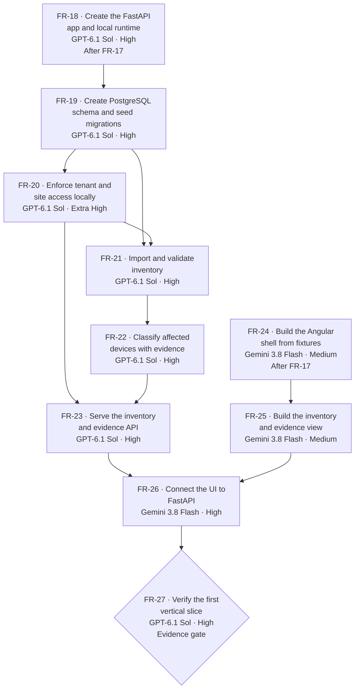

| Block | Owner · model · reasoning | Blocked by | Build | Done when |
| --- | --- | --- | --- | --- |
| **FR-18** Create the FastAPI app and local runtime | Codex · GPT-6.1 Sol · High | FR-17 | Wire typed configuration, local Compose, and a minimal health route. Keep the API and future worker in one Python codebase. | A clean clone starts the API and PostgreSQL with the documented command. The health check responds after startup. |
| **FR-19** Create PostgreSQL schema and seed migrations | Codex · GPT-6.1 Sol · High | FR-18 | Add tenant-qualified keys and foreign keys, typed migrations, and useful inventory indexes. Preserve raw evidence alongside normalized facts and build an idempotent seed. | A fresh DB migrates and seeds twice with the same result. A cross-tenant relationship is rejected. An EXPLAIN run on a representative larger fixture checks the indexed inventory path. |
| **FR-20** Enforce tenant and site access locally | Codex · GPT-6.1 Sol · Extra High | FR-19 | Resolve caller identity through a dev-only issuer and look up roles and grants in the database. Enforce authorization in the API and query layer. Keep the dev issuer unavailable in hosted configuration. | Tests show a granted partner can see an allowed site, an ungranted site is hidden, and a partner cannot approve a proposal. |
| **FR-21** Import and validate inventory | Codex · GPT-6.1 Sol · High | FR-19, FR-20 | Validate synthetic CSV or JSON shape and bound upload size. Reject malformed rows with usable errors. Use a documented atomic batch policy and persist observed times and revisions. | Valid import is repeatable. An invalid batch leaves the database unchanged and identifies the rejected row without logging sensitive input. |
| **FR-22** Classify affected devices with evidence | Codex · GPT-6.1 Sol · High | FR-21 | Evaluate the curated product, release, and configuration facts against the pinned Cisco advisory. Surface source, revision, confidence state, and the reason. Treat missing facts as needs evidence. | Tests cover affected, unaffected, and needs evidence for the chosen advisory. A missing relevant configuration fact cannot produce a false clean result. |
| **FR-23** Serve the inventory and evidence API | Codex · GPT-6.1 Sol · High | FR-20, FR-22 | Implement scoped lists, evidence details, filters, stable keyset pagination, and aggregate counts. Add request and response schema tests. | A client walks a fixed fixture without skipping or repeating rows. The list, detail, and counts return only the caller's authorized records. |
| **FR-24** Build the Angular shell from fixtures | Antigravity · Gemini 3.8 Flash · Medium | FR-17 | Set up routes, navigation, shared loading and error patterns, and API types. Use an explicit dev fixture adapter so the screen can ship before the backend. | The browser can switch between synthetic customer fixtures and reach the inventory page. The production configuration selects the live API. |
| **FR-25** Build the inventory and evidence view | Antigravity · Gemini 3.8 Flash · Medium | FR-24 | Show filters, customer and site scope, affected state, stale or missing evidence, and advisory provenance. Make status text available independent of color. | Screenshots and a component test show all three advisory states plus empty, error, and loading states. |
| **FR-26** Connect the UI to FastAPI | Antigravity · Gemini 3.8 Flash · High | FR-23, FR-25 | Run the Angular view on the real API, preserving authentication and paging. Add Playwright coverage for switching scope, filtering, and opening evidence. | The test uses the real API and database. It fails if the advisory state, reason, or tenant scope changes unexpectedly. |
| **FR-27** Verify the first vertical slice | Codex · GPT-6.1 Sol · High | FR-26 | Check a clean-clone run, inventory and evidence tests, and the browser evidence. Record this milestone while the planner work continues. | One-command startup and the passing CI run are linked. The browser can show the three outcomes on two customer scopes. |

## Phase 3

### Planner and independent validator

Keep the scheduler pure. Run the validator independently before using the resulting waves in the API.

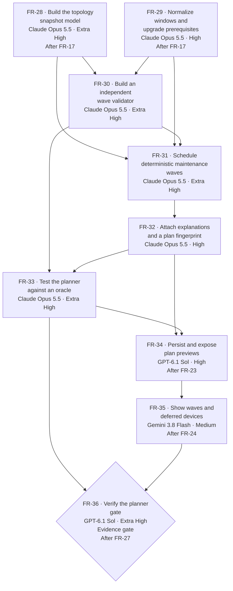

| Block | Owner · model · reasoning | Blocked by | Build | Done when |
| --- | --- | --- | --- | --- |
| **FR-28** Build the topology snapshot model | Claude Code · Claude Opus 5.5 · Extra High | FR-17 | Represent devices, links, uplinks, and protected services with explicit health and evidence ages. Model site-local redundancy groups and pin a deterministic snapshot. | Tests cover a missing alternate link, stale peer, disconnected critical service, and repeated input producing the same snapshot ordering. |
| **FR-29** Normalize windows and upgrade prerequisites | Claude Code · Claude Opus 5.5 · High | FR-17 | Use timezone-aware input and UTC half-open intervals. Validate blackout overlap, deadline, wave duration, a canary prerequisite, and approved target eligibility. | Window tests cover a boundary, a daylight-saving ambiguity, an insufficient window, and a target that requires manual review. |
| **FR-30** Build an independent wave validator | Claude Code · Claude Opus 5.5 · Extra High | FR-28, FR-29 | Treat unhealthy, stale, or in-wave assets and links as unavailable for the modeled path. Check protected service reachability, site and group limits, and prerequisites separately from the scheduling heuristic. | A valid wave passes. Taking both redundant paths down, breaking a blackout, or missing fresh supporting evidence fails with specific reasons. |
| **FR-31** Schedule deterministic maintenance waves | Claude Code · Claude Opus 5.5 · Extra High | FR-28, FR-29, FR-30 | Use a stable priority order by deadline, service criticality, and ID. Schedule the canary first and place later eligible waves within policy. Return an explicit deferral reason when placement fails. | The fixed fixture yields the same ordered waves on repeat. The validator accepts every emitted wave. At least one feasible multi-wave fixture progresses. |
| **FR-32** Attach explanations and a plan fingerprint | Claude Code · Claude Opus 5.5 · High | FR-31 | Record the snapshot and policy revision, ordered waves, reason codes, and evidence references. Use a canonical representation for a reproducible plan hash. | Equivalent input ordering yields the same fingerprint. A material change yields a new revision and traceable explanation. |
| **FR-33** Test the planner against an oracle | Claude Code · Claude Opus 5.5 · Extra High | FR-30, FR-32 | Add fixture and property-based tests with a simple independent reachability oracle on small graphs. Cover cycles in physical topology, impossible prerequisites, timing boundaries, and invalid candidate lists. | Fixed seeds reproduce failures. Each output satisfies constraints under the independent test oracle, including cases that schedule zero eligible devices for a valid reason. |
| **FR-34** Persist and expose plan previews | Codex · GPT-6.1 Sol · High | FR-23, FR-32, FR-33 | Adapt tenant-scoped database snapshots to the pure planner. Store immutable revisions, their evidence, and deferrals behind the agreed REST contract. | API tests return the expected waves and reasons for the seeded site. A new snapshot creates a new revision without changing the old one. |
| **FR-35** Show waves and deferred devices | Antigravity · Gemini 3.8 Flash · Medium | FR-24, FR-34 | Render the canary, wave windows in site time, protected service details, scope, and per-device deferrals. Use the generated contract to show source and revision. | The preview from the live API shows correct wave order and reasons with keyboard navigation. |
| **FR-36** Verify the planner gate | Codex · GPT-6.1 Sol · Extra High | FR-27, FR-33, FR-35 | Compare the casebook to the planner, independent validation, and browser display. Check that generated inputs cannot cross tenant boundaries. | The gate links the oracle tests and one valid and one impossible plan. Codex records review findings against Claude's exact PR head. |

## Phase 4

### Approvals, rehearsal, and audit

Bind approval to an immutable revision and prove a previously approved wave can still be stopped before it starts.

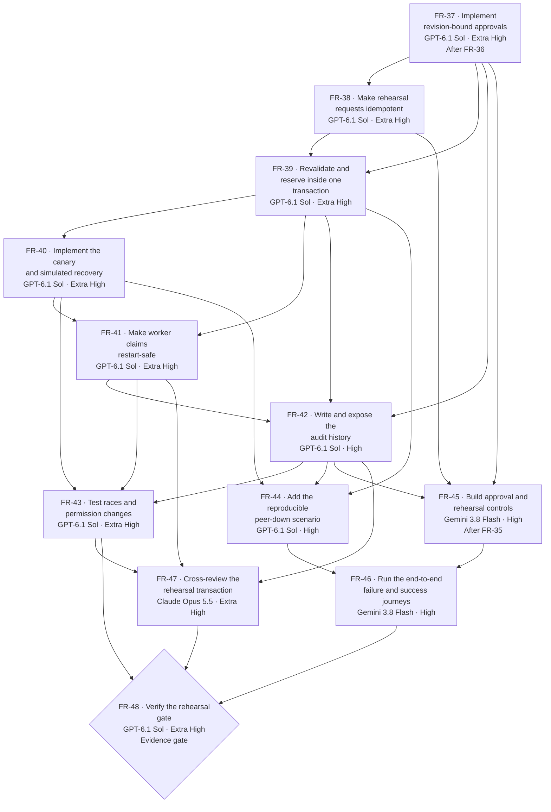

| Block | Owner · model · reasoning | Blocked by | Build | Done when |
| --- | --- | --- | --- | --- |
| **FR-37** Implement revision-bound approvals | Codex · GPT-6.1 Sol · Extra High | FR-36 | Define allowed transitions, actors, and optimistic preconditions. Store who approved which revision and fingerprint. A revised plan requires a new approval. | A customer approver can approve the selected revision. An outdated precondition and partner self-approval are rejected, with no state change. |
| **FR-38** Make rehearsal requests idempotent | Codex · GPT-6.1 Sol · Extra High | FR-37 | Scope the idempotency key to the tenant and action. Store a request fingerprint and stable run result, reject conflicting reuse, and check actor scope. | Two identical requests get one run. Reusing the same key with a different request fails, and a cross-tenant caller receives no existing run information. |
| **FR-39** Revalidate and reserve inside one transaction | Codex · GPT-6.1 Sol · Extra High | FR-37, FR-38 | Start site-local waves with a site guard locked before reading fresh evidence, policy, approval, and grants. Call the independent validator. Serialize starts against evidence and policy changes, enforce one active wave per site, and make the block or start atomic. | Integration tests prove two contenders at one site cannot both start, separate sites can proceed, and newer blocked evidence wins if committed before the start transaction. |
| **FR-40** Implement the canary and simulated recovery | Codex · GPT-6.1 Sol · Extra High | FR-39 | Execute deterministic simulated steps. Verify canary results before releasing later waves. Mark partial failures with per-device outcomes and simulate a rollback or pause with explicit reason. | A passing canary releases the next wave. A failing canary leaves it stopped and exposes the per-device result and recovery state. |
| **FR-41** Make worker claims restart-safe | Codex · GPT-6.1 Sol · Extra High | FR-39, FR-40 | Persist claims and step completion, fence stale workers, and reconcile ambiguous claims before releasing a reservation. Keep simulated side effects idempotent by wave and step. | A restart immediately after a committed simulation step resumes the same run without an extra start. An obsolete worker cannot mark success or release another worker's reservation. |
| **FR-42** Write and expose the audit history | Codex · GPT-6.1 Sol · High | FR-37, FR-39, FR-41 | Persist append-only application audit events with actor, revision, reason, correlation ID, and relevant evidence in the same transaction as each state transition. Expose a scoped timeline. | The approval and blocked event are attributable and ordered, with no sensitive fields. Failing a write rolls back its associated state change. |
| **FR-43** Test races and permission changes | Codex · GPT-6.1 Sol · Extra High | FR-40, FR-41, FR-42 | Use a real PostgreSQL DB for concurrent claims, permission revocation, stale approval, window closing during a queue delay, and failed canary. Record the observed result instead of relying on timing sleeps. | Required CI tests exercise both orderings for relevant races. The same-site reservation, current authorization, and stale-evidence checks hold. |
| **FR-44** Add the reproducible peer-down scenario | Codex · GPT-6.1 Sol · High | FR-39, FR-40, FR-42 | Expose a seeded simulator scenario or maintainer-controlled test command. Commit the peer outage after approval and before the next wave, using the same evidence path the worker reads. | A deterministic trace shows approval, the new outage observation, an attempted start, and alternate_path_unavailable with no simulated action for that wave. |
| **FR-45** Build approval and rehearsal controls | Antigravity · Gemini 3.8 Flash · High | FR-35, FR-37, FR-38, FR-42 | Add role-aware actions and views for approval revision, run progress, idempotent retry, blocked reason, per-device outcome, and audit timeline. Keep server responses authoritative. | The console distinguishes approval, running, blocked, and partial failure. Stale approvals and forbidden actions receive actionable messages. |
| **FR-46** Run the end-to-end failure and success journeys | Antigravity · Gemini 3.8 Flash · High | FR-44, FR-45 | Drive the live UI with seeded partner and approver roles, run the normal path, and reproduce the outage after approval. Assert the stopped wave and corresponding audit reason. | Playwright artifacts link both journeys. Assertions use real API state and the browser, including that the blocked wave emitted no simulator start event. |
| **FR-47** Cross-review the rehearsal transaction | Claude Code · Claude Opus 5.5 · Extra High | FR-41, FR-42, FR-43 | Review Codex's exact commit as an independent reader. Check lock ordering, freshness reads, revocation, fencing, idempotency, and transactionally written audit events. | Findings cite files and scenarios. Blocking issues are fixed or resolved by a test before the gate. |
| **FR-48** Verify the rehearsal gate | Codex · GPT-6.1 Sol · Extra High | FR-43, FR-46, FR-47 | Collect the combined evidence for the passing case, peer-down-after-approval, failed canary, and the restart/race tests. | One commit passes planner, API, worker, and browser checks. Every blocked case shows the audit reason and zero invalid starts in the scenario. |

## Phase 5

### Kafka and recovery

Make accepted evidence durable and prove retries and delayed delivery preserve the same operational state.

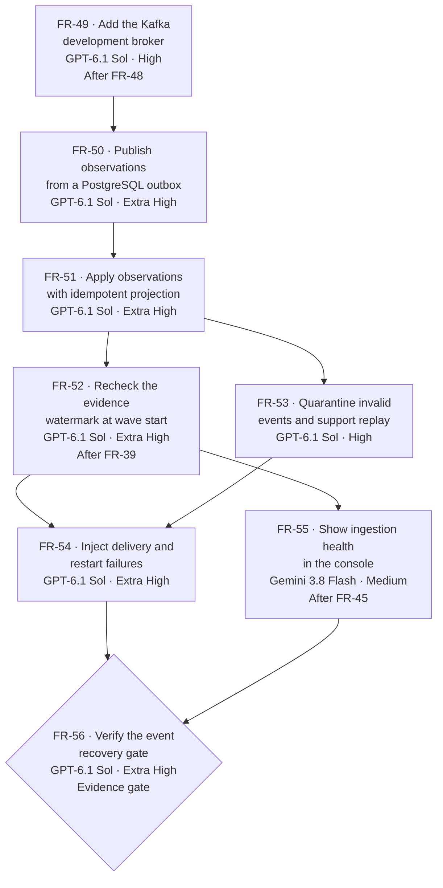

| Block | Owner · model · reasoning | Blocked by | Build | Done when |
| --- | --- | --- | --- | --- |
| **FR-49** Add the Kafka development broker | Codex · GPT-6.1 Sol · High | FR-48 | Pin a broker image and add one versioned topic to Compose. Key observation events by tenant and asset. Record the separation between observation delivery and durable simulation steps. | Local startup, shutdown, and a produce-consume smoke test work from a clean clone without external credentials. |
| **FR-50** Publish observations from a PostgreSQL outbox | Codex · GPT-6.1 Sol · Extra High | FR-49 | Store the validated input, relevant accepted revision, and publishable event atomically. Relay after commit and mark published after broker acknowledgement. Design relay recovery for duplicate publication. | Kill the relay between send and publish bookkeeping. Recovery republishes as needed, and the event stays recoverable from PostgreSQL. |
| **FR-51** Apply observations with idempotent projection | Codex · GPT-6.1 Sol · Extra High | FR-50 | Use unique event IDs, monotonic versions scoped to the source and asset, and ordered processing per partition. Commit offsets after the database transaction and avoid advancing past an unprocessed event. | A duplicate makes one state change. A late older observation cannot overwrite newer evidence. Restart after commit before offset acknowledgement leaves the same result. |
| **FR-52** Recheck the evidence watermark at wave start | Codex · GPT-6.1 Sol · Extra High | FR-39, FR-51 | Under the same site guard, compare the required accepted revisions with applied state and enforce age and data completeness. Include freshness, coverage exceptions, and the current policy revision in the check. | A relevant accepted update that is still pending blocks the start. Once projected, the same fixture either proceeds safely or gives the new block reason. |
| **FR-53** Quarantine invalid events and support replay | Codex · GPT-6.1 Sol · High | FR-51 | Capture sanitized failure details and preserve the skipped event's effect on readiness. Provide a bounded, tenant-scoped replay for synthetic test data and document how to clear a repaired case. | Invalid payloads are visible, unrelated work progresses, and a successful repair plus replay yields the expected state without unblocking an unrepaired affected wave. |
| **FR-54** Inject delivery and restart failures | Codex · GPT-6.1 Sol · Extra High | FR-52, FR-53 | Exercise duplicates, late observations, a paused broker or worker, restart between commit and acknowledgement, and restoration of the correct snapshot. Assert the application state after replay. | CI shows durable recovery from each failure with the expected projection and one logical start at most per wave. |
| **FR-55** Show ingestion health in the console | Antigravity · Gemini 3.8 Flash · Medium | FR-45, FR-52 | Show last-observed time, pending evidence, stale state, and the updated block reason in the scoped view. Use text and concise next action. | A test shows pending evidence before delivery and the correct updated state afterward. Other tenants' ingestion details remain out of view. |
| **FR-56** Verify the event recovery gate | Codex · GPT-6.1 Sol · Extra High | FR-54, FR-55 | Gather evidence from the pinned event protocol, replay tests, worker logs, and the real console. Repeat the peer-down-after-approval test through Kafka. | Replay leaves the expected final projection and audit trail. The end-to-end case still blocks without an invalid start while evidence is pending or unhealthy. |

## Phase 6

### Security, observability, and CI

Establish the code-level release gates while infrastructure is being planned. Use synthetic inputs in tests and telemetry.

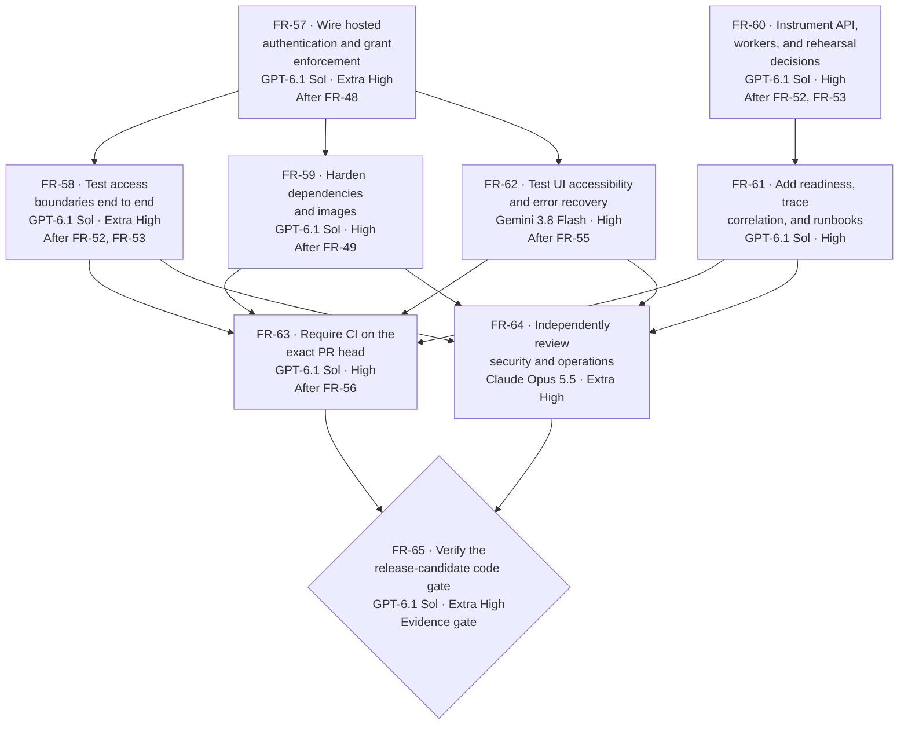

| Block | Owner · model · reasoning | Blocked by | Build | Done when |
| --- | --- | --- | --- | --- |
| **FR-57** Wire hosted authentication and grant enforcement | Codex · GPT-6.1 Sol · Extra High | FR-48 | Validate signed tokens for the expected issuer, audience, and expiry, and resolve role and site grants from current application data. Choose the hosted OIDC provider and browser flow. Require the hosted identity configuration. | Integration tests cover rejected and expired identities, revoked grants, and a production configuration that refuses dev credentials or dev fixture routes. |
| **FR-58** Test access boundaries end to end | Codex · GPT-6.1 Sol · Extra High | FR-52, FR-53, FR-57 | Exercise cross-tenant lists, details, counts, pagination cursors, plan/approval IDs, events, replay, and audit routes with two synthetic customers. Check application logs and response errors for unintended disclosure. | A denied caller receives no rows, counts, or evidence from the other tenant. Unauthorized approval and start requests have no side effect. |
| **FR-59** Harden dependencies and images | Codex · GPT-6.1 Sol · High | FR-49, FR-57 | Pin runtime versions and third-party Actions by commit SHA. Keep builds repeatable and scan dependencies, images, and committed secrets. Run containers as a non-root user where supported. | CI produces reviewable scan output and a clean builder uses the pinned inputs and lockfiles. Blocking scan findings are fixed or explicitly resolved. |
| **FR-60** Instrument API, workers, and rehearsal decisions | Codex · GPT-6.1 Sol · High | FR-52, FR-53 | Export bounded-cardinality Prometheus metrics for latency, queue lag, freshness, rejected starts, and failed verifications. Add a Grafana dashboard and scrub sensitive data. | Replaying the incident produces observable lag and a blocked-wave reason. Metric labels omit tenant, asset, and request IDs. |
| **FR-61** Add readiness, trace correlation, and runbooks | Codex · GPT-6.1 Sol · High | FR-60 | Define API readiness and worker health behavior. Carry a correlation ID from request to audit and logs. Set actionable alert thresholds and a runbook for lag and repeated failures. | An operator can trace the demo incident to its audit event and distinguish an intentional application block from an infrastructure incident. |
| **FR-62** Test UI accessibility and error recovery | Antigravity · Gemini 3.8 Flash · High | FR-55, FR-57 | Check keyboard operation, focus, labels, readable status text, layout, time zones, and retry/error paths on inventory, planning, and rehearsal screens. | Browser evidence covers tab navigation and accessible status. Hosted auth and a failed request leave the console in a recoverable state. |
| **FR-63** Require CI on the exact PR head | Codex · GPT-6.1 Sol · High | FR-56, FR-58, FR-59, FR-61, FR-62 | Run lint, builds, unit and PostgreSQL/Kafka integration tests, migration checks, OpenAPI drift checks, and Playwright. Publish test and screenshot artifacts and use a single required aggregate check that fails for skipped mandatory jobs. | A deliberate stale schema, skipped test suite, or failing test blocks the aggregate check. main requires the check where the GitHub plan supports it. |
| **FR-64** Independently review security and operations | Claude Code · Claude Opus 5.5 · Extra High | FR-58, FR-59, FR-61, FR-62 | Review the authentication, migration, observability, and runtime boundary changes at a pinned commit. Check no cloud credentials or real device endpoints are exposed to build agents. | Findings are linked to fixes or recorded dispositions. Release-blocking defects are closed with evidence. |
| **FR-65** Verify the release-candidate code gate | Codex · GPT-6.1 Sol · Extra High | FR-63, FR-64 | Prepare a CI and review evidence bundle for the exact candidate commit. Confirm the synthetic runtime scope and verify all normal and failure journeys. | Required checks are green and the candidate SHA is recorded. Staging can use only a candidate that passed this gate. |

## Phase 7

### Terraform, EKS, and staging

Prepare the infrastructure in parallel with code hardening. Provision only the AWS environment you approve.

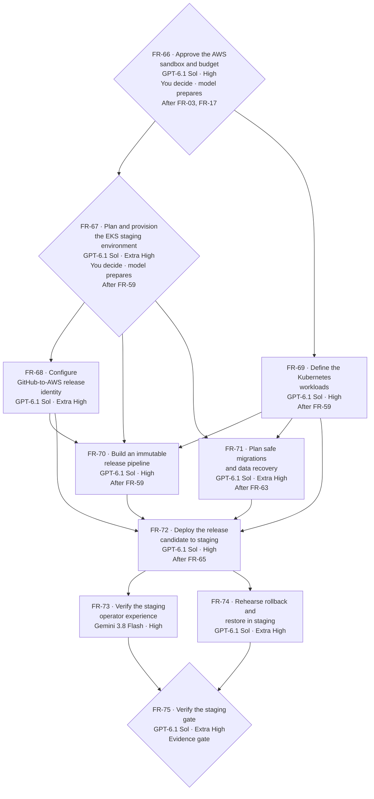

| Block | Owner · model · reasoning | Blocked by | Build | Done when |
| --- | --- | --- | --- | --- |
| **FR-66** Approve the AWS sandbox and budget | You decide. Codex prepares · GPT-6.1 Sol · High | FR-03, FR-17 | Choose the account, region, owner, maximum expected spend, alert recipients, and teardown date. Estimate EKS, compute, RDS, registry, load balancer, and broker costs. Confirm permissions and the planned runtime topology. | You authorize a specific environment and spend window. The estimate and cleanup owner are recorded. Creating or applying infrastructure needs this gate. |
| **FR-67** Plan and provision the EKS staging environment | You decide. Codex prepares · GPT-6.1 Sol · Extra High | FR-59, FR-66 | Write Terraform for reviewed state and locking, a tagged VPC, EKS, private RDS PostgreSQL, ECR, and ingress prerequisites. You review the plan and apply it with the staging bootstrap identity near the staging window. | terraform validate passes and the applied resources match the reviewed staging plan. ECR exists for publishing and RDS is reachable only from the intended application path. |
| **FR-68** Configure GitHub-to-AWS release identity | Codex · GPT-6.1 Sol · Extra High | FR-67 | Configure staging for short-lived OIDC sessions and plan a distinct production role. Scope trust to the repository and approved ref or environment. Document the human-controlled release path available on your GitHub plan. | The staging workflow can assume only its intended role. The proposed production trust has no PR or unapproved-ref path, which is checked again against the hosted environment. |
| **FR-69** Define the Kubernetes workloads | Codex · GPT-6.1 Sol · High | FR-59, FR-66 | Deploy the API, worker, and Angular service with resources, probes, network boundaries, and configuration. For the synthetic demo use one internal persistent Kafka broker. Use the approved ingress and private database path. | Manifest validation and a local Kubernetes smoke test pass. Workloads have distinct identities and a healthy restart path. The demo broker's recovery limit is recorded. |
| **FR-70** Build an immutable release pipeline | Codex · GPT-6.1 Sol · High | FR-59, FR-67, FR-68, FR-69 | On trusted main builds, publish API/worker and web images to ECR. Capture their digests, source SHA, and scan evidence in a release manifest. Scope release jobs and their triggers. | Staging and production jobs consume the same digest manifest. A PR or mutable image tag cannot silently select what production runs. |
| **FR-71** Plan safe migrations and data recovery | Codex · GPT-6.1 Sol · Extra High | FR-63, FR-67, FR-69 | Run migrations once per release with serialization, using schema changes compatible with the preceding app version during rollback. Enable RDS backup retention and write a restore drill with measured objectives. | Fresh and prior-schema upgrades pass. A previous image can run against the migrated schema. The restore steps have an owner and target RTO/RPO. |
| **FR-72** Deploy the release candidate to staging | Codex · GPT-6.1 Sol · High | FR-65, FR-68, FR-69, FR-70, FR-71 | Verify the provisioned staging environment, then run the migration job and deploy the pinned digests. Validate health, TLS, access, and the live browser smoke test. | The staging release uses the source SHA and digests from the release manifest. Services are reachable only as intended. The demo runs on EKS against RDS. |
| **FR-73** Verify the staging operator experience | Antigravity · Gemini 3.8 Flash · High | FR-72 | Run the approved browser journeys, tenant switching, stale evidence, and both release paths over the staging ingress. Capture the audit timeline and an accessible example. | Staging shows the normal and peer-down outcomes, and the screenshot and test artifacts identify the tested commit and environment. |
| **FR-74** Rehearse rollback and restore in staging | Codex · GPT-6.1 Sol · Extra High | FR-72 | Roll back to a previously tested digest or seeded previous release, verify schema compatibility, restore a backup into an isolated DB, and restart a worker during a simulated run. Redeploy the candidate after the drill. | Smoke passes after rollback, restore, and return to the candidate digest. Measured recovery figures are captured and retry leaves the same rehearsal outcome. |
| **FR-75** Verify the staging gate | Codex · GPT-6.1 Sol · Extra High | FR-73, FR-74 | Compare the release manifest, staging smoke, recovery drill, access controls, dashboard, and ongoing costs. Record the staged evidence for the human release decision. | The candidate manifest has exact digests, a rollback reference, and passing staging evidence. Unresolved operational risks block promotion. |

## Phase 8

### Benchmark, release, and ownership

Measure the real build. Promote the approved digests to a hosted simulator only after the release owner signs off.

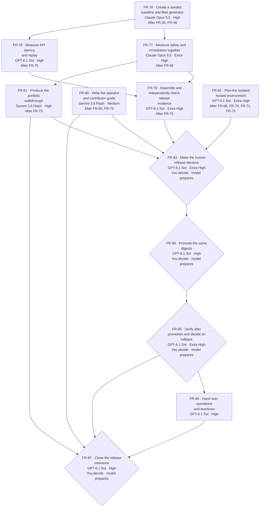

| Block | Owner · model · reasoning | Blocked by | Build | Done when |
| --- | --- | --- | --- | --- |
| **FR-76** Create a seeded baseline and fleet generator | Claude Code · Claude Opus 5.5 · High | FR-33, FR-48 | Generate reproducible sites, asset criticality, windows, and injected failures. Implement the severity-first baseline under the same input schedule and evaluate both with a shared independent oracle. | A documented seed produces identical inputs for both planners. Each baseline outcome can be traced and checked against the same constraints. |
| **FR-77** Measure safety and remediation together | Claude Code · Claude Opus 5.5 · Extra High | FR-56, FR-76 | Compare invalid proposed or started waves, affected-device hours over a fixed horizon, eligible devices finished by deadline, and deferral reasons. Separate simulated outcomes from wall-clock measurements. | The report includes workload, seeds, coverage, misses, and baseline comparison. Required rehearsal scenarios show zero invalid starts, with useful work also completing. |
| **FR-78** Measure API latency and replay | Codex · GPT-6.1 Sol · High | FR-75, FR-76 | Test a 10,000-asset fixture and a 50,000-event replay with duplicates and a worker restart. Target below 300 ms p95 for the first risk page at 25 requests per second. Record environment, errors, and steady-state load. | Publish actual results, resource sizes, and commands. Assert the expected state after replay and at most one logical start per wave. A missed target is tracked. |
| **FR-79** Assemble and independently check release evidence | Codex · GPT-6.1 Sol · Extra High | FR-75, FR-77, FR-78 | Pin test results, benchmark measurements, manifest, dashboards, restore and rollback reports, data provenance, and known limits to the candidate SHA. Distinguish acceptance criteria from performance targets. | Each launch requirement points to a passing artifact. You resolve any failed requirement and explicitly accept any missed performance target. |
| **FR-80** Write the operator and contributor guide | Antigravity · Gemini 3.8 Flash · Medium | FR-65, FR-75 | Document the one-command local start, synthetic identities, hero scenario, architecture, review model, known limits, and resource costs. Explain how to reproduce the evidence. | A fresh reader can run the demo from a clone and find the contract, screenshots, and benchmark commands. |
| **FR-81** Produce the portfolio walkthrough | Antigravity · Gemini 3.8 Flash · High | FR-73, FR-77 | Prepare and record a short demo with normal plan, approval, peer outage, blocked audit event, and relevant Grafana signals. Tie each segment to what the project demonstrates for Cisco. | A viewer can reproduce the staged scenario. Results shown match the same synthetic data and measured evidence. |
| **FR-82** Plan the isolated hosted environment | Codex · GPT-6.1 Sol · Extra High | FR-68, FR-70, FR-71, FR-75 | Prepare a Terraform plan and release identity for separate hosted state, data stores, credentials, TLS, restricted demo access, and backups. Record the operating limits and first-release backout steps. | You can identify the exact account, release ref, intended environment, DB, and previous digest if one exists. The approved configuration keeps production credentials out of agent worktrees. |
| **FR-83** Make the human release decision | You decide. Codex prepares · GPT-6.1 Sol · Extra High | FR-79, FR-80, FR-81, FR-82 | Prepare the go/no-go entry with approved digests, staging outcomes, operational thresholds, rollback steps, owner, and spend limits. You approve promotion. | The release issue records the decision and deployable artifact. An unapproved or superseded candidate stays in staging. |
| **FR-84** Promote the same digests | You decide. Codex prepares · GPT-6.1 Sol · High | FR-83 | You apply the approved hosted infrastructure if needed and verify its role and access boundaries. Trigger the release workflow for the reviewed manifest. Run the compatible migration job and deploy the exact staged API/worker and web digests. | The workflow records actor, commit, digests, migration result, and rollout status. A failed check holds the release for the runbook decision. |
| **FR-85** Verify after promotion and decide on rollback | You decide. Codex prepares · GPT-6.1 Sol · Extra High | FR-84 | Check readiness, scope and auth, synthetic smoke, dashboard and error rates. Watch a defined verification window. Escalate on access, correctness, or severe reliability regressions. | Publish a verified live release entry. On failure, use the last verified digest and repeat smoke. For a first release without a prior digest, close access and record the failure before retrying. |
| **FR-86** Hand over operations and teardown | Codex · GPT-6.1 Sol · High | FR-85 | Link deployment, alerts, incident owner, backup retention, maintenance, dependency update cadence, and teardown instructions. Verify environment and preserved backups before any deletion. | The maintainer can find how to pause, recover, redeploy, or close the environment, and sees who is responsible for ongoing costs. |
| **FR-87** Close the release milestone | You decide. Codex prepares · GPT-6.1 Sol · High | FR-80, FR-81, FR-85, FR-86 | Collect the URL or recorded demo, reproducibility instructions, evidence summary, and accurate project highlights. You close the milestone and record the next decision. | One release or milestone links the verified commit, demo, metrics, and operating instructions. Results describe a hosted simulation and its measured bounds. |

## Phase 9

### Optional work after release

Start these only when the hosted simulator is stable and you approve the extra scope.

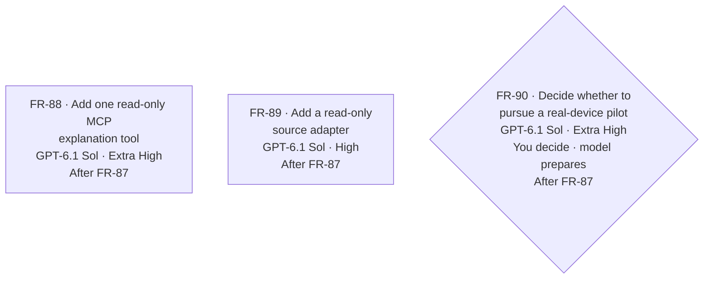

| Block | Owner · model · reasoning | Blocked by | Build | Done when |
| --- | --- | --- | --- | --- |
| **FR-88** Add one read-only MCP explanation tool | Codex · GPT-6.1 Sol · Extra High | FR-87 | Expose a blocked-wave explanation from the existing typed API. Inherit the caller's scope and use the same evidence model and audit controls. | The tool returns the same decision as the API for an authorized user. An ungranted tenant yields no explanation or identifying details. |
| **FR-89** Add a read-only source adapter | Codex · GPT-6.1 Sol · High | FR-87 | With authorized account access, add an explicitly configured import for approved Cisco evidence. Preserve its source and version, validate schema, rate-limit, and keep deterministic fixtures runnable. | A sandbox or authorized connector can be disabled without breaking the demo. Imported data passes schema and scope tests and remains traceable. |
| **FR-90** Decide whether to pursue a real-device pilot | You decide. Codex prepares · GPT-6.1 Sol · Extra High | FR-87 | Prepare a separate proposal with the asset owner's authorization, supported environment, human change control, data handling, rollback ownership, and operational reliability requirements. You decide whether to commission it. | A signed-off pilot scope exists before any live work. The portfolio deployment continues to execute only its synthetic scenarios. |

## Cisco project rationale

The internship pools several teams. Cisco IQ Configuration is the closest public example for the Python and Angular choices, the approval workflow, and the emphasis on partial failures. The project applies those ideas to a partner's own topology, windows, and failure rehearsal. [Cisco internship posting](https://talentbridge.cisco.com/en/job/software-engineer-full-stack-backend-i-intern-united-states-57626) · [Cisco IQ Configuration job archive](https://builtin.com/job/software-engineer/10707527) · [Cisco IQ API engineering](https://blogs.cisco.com/customerexperience/cisco-iq-engineering-apis-for-the-agentic-era)
